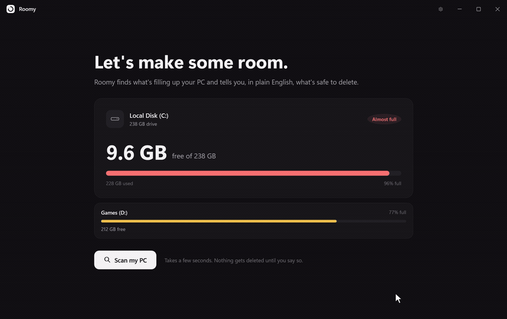
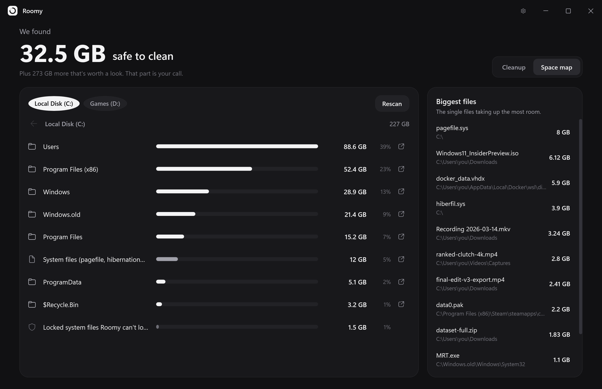
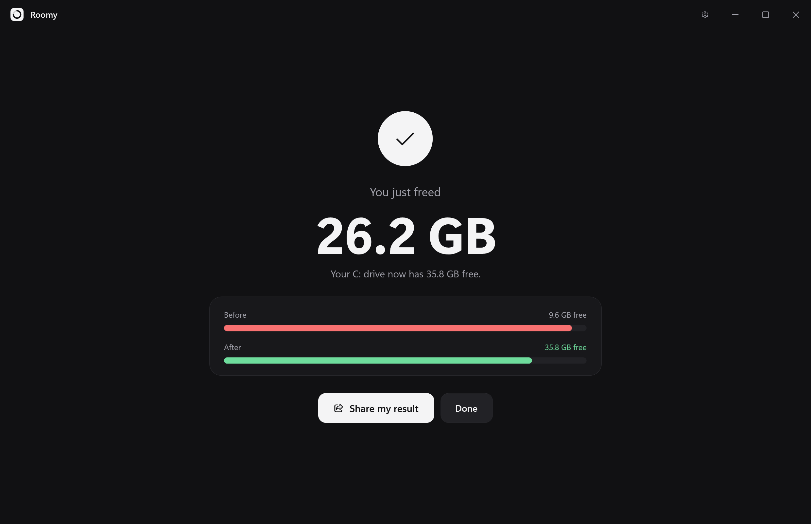

<p align="center">
  
</p>

<h1 align="center">Roomy</h1>

<p align="center">
  <b>Your C: drive is full. Let's fix that.</b><br>
  See what's eating your space in plain English, and clean the safe stuff in one click.
</p>

<p align="center">
  <a href="https://github.com/krezio/roomy/releases/latest"></a>
  <a href="https://github.com/krezio/roomy/releases"></a>
  <a href="https://github.com/krezio/roomy/stargazers"></a>
  
  
  <a href="https://roomy.krezio.xyz"></a>
</p>

<p align="center">
  <a href="https://roomy.krezio.xyz"></a>
</p>

<p align="center">
  <a href="https://apps.microsoft.com/detail/9P983BK0XVMC?mode=direct"></a>
</p>

<p align="center">
  <a href="https://github.com/krezio/roomy/releases/latest/download/Roomy-Setup.exe"><b>⬇ Download for Windows</b></a> &nbsp;·&nbsp;
  <a href="https://roomy.krezio.xyz">Website &amp; live demo</a> &nbsp;·&nbsp;
  <a href="https://roomy.krezio.xyz/guides/">Guides</a>
</p>

> ⭐ **If Roomy freed up space for you, a star helps other people find it.** It takes one click and it genuinely helps.

## Why

Most cleaners stick to temp files and the Recycle Bin, and Windows' own tools miss a lot. Roomy also goes after the space they usually skip (GPU shader caches, app caches, Windows Update leftovers, forgotten Steam games), and it tells you **what** each thing is, **why** it's there and **whether it's safe** before you touch anything. Free, offline, open source.

## What it finds

| | Category | Default |
|---|---|---|
| ♻️ | Windows Update leftovers, Delivery Optimization, Windows temp (needs admin) | ✅ Safe |
| 🧩 | App caches: Discord, Spotify, VS Code, Slack, Teams, npm, pip, Yarn, NuGet, and game launchers (Steam, Epic, Battle.net, EA app, Ubisoft Connect, Riot Client, GOG Galaxy) | ✅ Safe |
| 🌐 | Browser caches: Chrome, Edge, Brave, Vivaldi, Firefox, Opera | ✅ Safe |
| 🕒 | Temp files (older than a day), crash dumps, error reports, Recycle Bin | ✅ Safe |
| 🎨 | GPU shader caches (NVIDIA, AMD, Intel, DirectX, Steam) | Safe, unticked |
| 📦 | Old installers & big untouched downloads | Your call |
| 🎮 | Steam games you haven't played in 2+ months (uninstalls through Steam) | Your call |
| 🪟 | `Windows.old` (opens Windows' own cleanup) | Your call |
| 🗂️ | Leftover AppData folders from apps you've uninstalled (50 MB+, untouched for 3+ months) | Your call |
| 💤 | The hidden hibernation file, often 6–16 GB (turns hibernation off through Windows, and back on from Settings) | Your call |

Plus a **Space map** that lets you click down through any drive folder by folder and see the biggest files on your PC.

## Background checks

Open **Settings** using the gear in the title bar. Background features are optional and start turned off.

- **Keep Roomy in the system tray:** closing the window keeps Roomy running. The tray menu lets you open Roomy, scan, pause reminders or quit.
- **Start with Windows:** launch quietly in the tray when you sign in. Roomy respects startup choices made in Windows Settings and Task Manager.
- **Low-space alerts:** check your system drive every 30 or 60 minutes. Choose a threshold from 1 to 500 GB (10 GB by default). These checks only read available disk space.
- **Weekly cache checks:** starting one week after you enable them, check temporary files, browser caches, app caches and crash reports. Checks wait for five minutes of inactivity and pause on battery power or when you start using the PC. They stop after five minutes and can try again later.
- **Reminders:** at most one per day across both kinds of check, with a one-day pause and Windows notification controls. Weekly reminders require at least 1 GB of cleanup candidates. Review always opens a fresh scan; nothing is automatically deleted.

Preferences, reminder cooldowns and snooze times stay in `%LOCALAPPDATA%\Roomy\settings.json`. Background checks run while Roomy is open or in the tray. **Quit Roomy** stops them until the next launch. Elevated sessions do not run background checks. Demo settings are temporary and do not register startup or send Windows notifications.

<p align="center">
  
  
</p>

## Privacy & safety

- **Read-only scan.** Nothing is deleted until you click *Clean up*.
- **Your folders are hard-blocked.** Documents, Desktop, Pictures, Videos, Music, Downloads (as a folder), your user folder, Windows and Program Files can never be wiped. See [`FileOps.Guard`](src/Roomy/Core/FileOps.cs).
- **Never follows junctions or symlinks**, so a link can't point the cleaner somewhere unexpected.
- **In-use files are skipped**, never forced.
- **"Your call" items start unticked** and ask for confirmation before anything is removed.
- **No network access at all.** No telemetry, no accounts, no updates phoning home. If Roomy ever crashes, it writes the error to `%LOCALAPPDATA%\Roomy\crash.log` on your PC so you can attach it to an issue. It's never sent anywhere.
- **Your choice of permanent or Recycle Bin.** By default, cleaned files are deleted for good, and Roomy says so before you confirm. Turn on *Send files from Downloads to the Recycle Bin* in Settings to be able to restore old installers and downloads. If a file is too big for the bin, Windows asks before deleting it.
- **No admin needed.** Roomy runs as a normal user. Only the *Windows leftovers* category (Windows Update downloads, Delivery Optimization cache, the Windows temp folder, system crash dumps) needs admin, and Roomy only asks if you click *Restart as admin*. Without it, that category is skipped.
- **Background checks never delete.** They only read free space and cache sizes, then show a reminder. Every cleanup is something you start.

Found something that looks unsafe? Please [open an issue](https://github.com/krezio/roomy/issues). Reviews of the cleanup code are very welcome.

## Languages

Roomy follows your Windows display language. It speaks **English**, **Русский** (thanks to [@KVGeorgich](https://github.com/KVGeorgich)) and **简体中文** (thanks to [@amaoo](https://github.com/amaoo)). Want Roomy in your language? See [src/Roomy/Localization](src/Roomy/Localization/README.md). You only add your language to one file.

## Install

**Easiest: [get Roomy from the Microsoft Store](https://apps.microsoft.com/detail/9P983BK0XVMC?mode=direct).** No "unknown publisher" warning, and it updates by itself.

Or grab **Roomy-Setup.exe** (installs per-user, no admin needed) or **Roomy-portable.exe** from [Releases](https://github.com/krezio/roomy/releases/latest).

Requires Windows 10 version 2004 or later, or Windows 11.

<p align="center">
  <video src="site/assets/video/roomy-demo.mp4" width="860" autoplay muted loop playsinline></video>
</p>

## Microsoft Store build

`packaging/build-msix.ps1` builds `dist/Roomy.msix` for Partner Center (the Store signs it). Pass the identity values from *Product management → Product identity*.

## Build it yourself

Requires the [.NET 10 SDK](https://dotnet.microsoft.com/download).

```bash
dotnet run --project src/Roomy                  # run it
dotnet run --project src/Roomy -- --demo        # fake data, safe for recordings
```

Release build (single self-contained exe):

```bash
dotnet publish src/Roomy -c Release -r win-x64 --self-contained -p:PublishSingleFile=true -p:IncludeNativeLibrariesForSelfExtract=true -p:EnableCompressionInSingleFile=true -o dist
```

Handy flags:

| Flag | What it does |
|---|---|
| `--demo` | Uses made-up data. Nothing on your PC is read or touched. |
| `--background` | Starts in the tray if background mode is enabled; otherwise exits. |
| `--shots <dir>` | Runs the demo and saves screenshots of every screen to `<dir>`. |
| `--scan-report <file>` | Runs a real, read-only scan and writes the results to a text file. |
| `--export-icon <file.ico>` | Renders the app icon. |

## Project layout

```
src/Roomy/
  Core/         scanning, cleaning, Steam library reader, safety guards (no UI)
  ViewModels/   state for each screen
  Controls/     animated bar, count-up text, spinner, logo
  MainWindow    the whole UI
installer/      Inno Setup script
site/           roomy.krezio.xyz
```

## Contributing

Run the background settings and reminder tests on Windows:

```bash
dotnet test tests/Roomy.Tests -c Release
```

Desktop lifecycle checks use demo data and temporary in-memory preferences. The optional notification check uses its own test-app identity and removes its notification and registration afterward:

```bash
dotnet run --project tests/Roomy.DesktopChecks -c Release
dotnet run --project tests/Roomy.DesktopChecks -c Release -- --notifications
```

Know a cache folder Roomy should clean, or found something it gets wrong? [Open an issue](https://github.com/krezio/roomy/issues) or send a pull request. And if Roomy helped you, a ⭐ really does help others find it.

**Also from krezio:** [Framecalm](https://github.com/krezio/framecalm), a free Windows optimizer for games that shows exactly what it changes and can undo all of it.

## License

[MIT](LICENSE) © 2026 krezio
